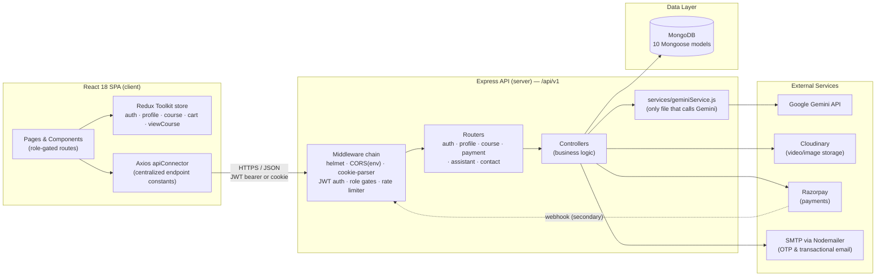
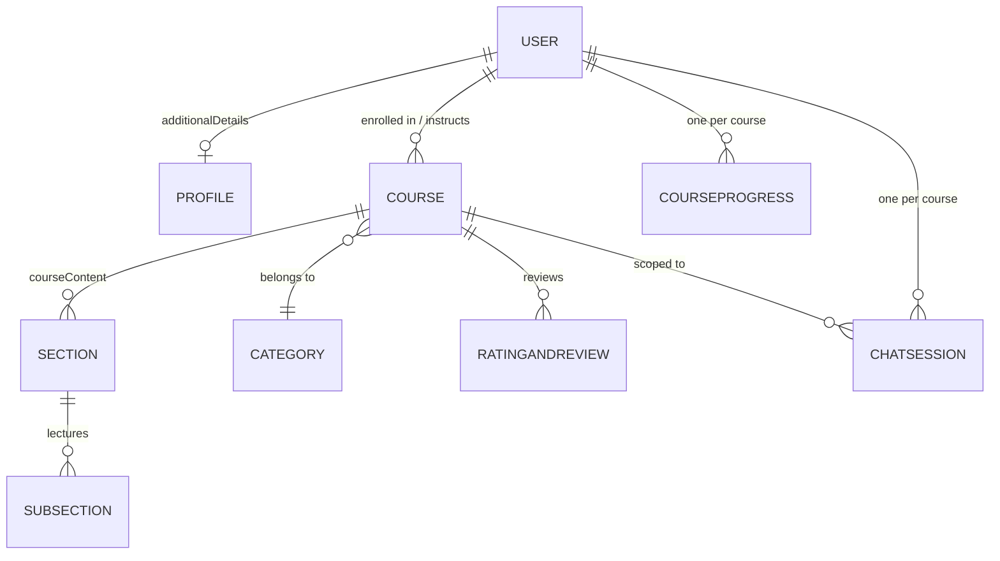
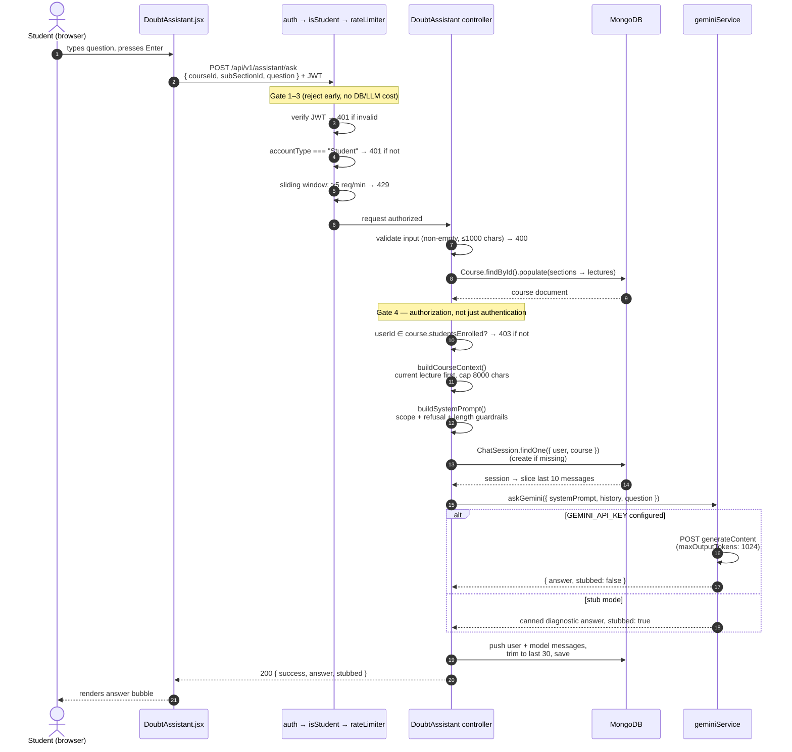
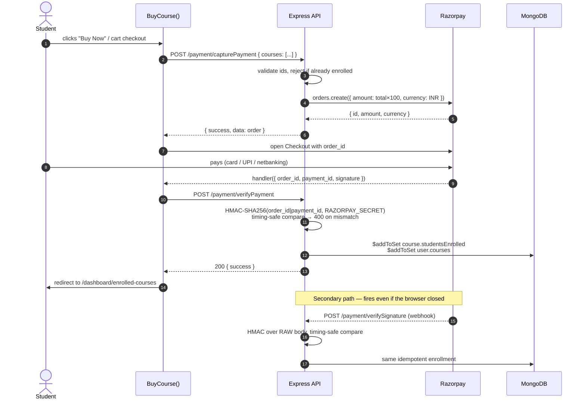

# Synapse

**A full-stack ed-tech platform (course marketplace + LMS) with an AI-powered Course Doubt Assistant.**

Students browse and purchase courses, watch video lectures, track their progress, and ask questions in an in-player chat panel that answers **using only that course's content**, powered by the Google Gemini API. Instructors author courses with nested sections and video lectures; admins manage categories.


---

## Table of Contents

- [Overview](#overview)
- [Key Features](#key-features)
- [Tech Stack](#tech-stack)
- [High-Level Design (HLD)](#high-level-design-hld)
- [Low-Level Design (LLD)](#low-level-design-lld)
- [Setup](#setup)
- [Usage](#usage)
- [API Overview](#api-overview)
- [Project Structure](#project-structure)
- [Security Posture](#security-posture)
- [Deployment](#deployment)
- [Engineering Decisions](#engineering-decisions)
- [Known Limitations](#known-limitations)

---

## Overview

Synapse has three user roles with distinct capabilities, enforced server-side by Express middleware:

| Role | Capabilities |
|---|---|
| **Student** | Browse catalog, purchase courses, watch lectures, track progress, rate courses, ask the AI Doubt Assistant |
| **Instructor** | Create/edit courses (Course → Sections → Lectures), upload videos, view an earnings dashboard |
| **Admin** | Manage course categories |

The headline feature is the **AI Course Doubt Assistant**: a chat panel inside the video player, available only to students enrolled in that course. The backend assembles context from the course's own data (name, description, section/lecture descriptions — with the currently-playing lecture prioritized), wraps it in a guardrailed system prompt, and calls Gemini. Answers are grounded in course content; off-topic questions are refused by design.

## Key Features

### Platform
- **Authentication & authorization** — JWT sessions (24h expiry, httpOnly cookie), email OTP verification on signup with **MongoDB TTL auto-expiry**, bcrypt password hashing (cost 10), and role-based access control middleware.
- **Course management** — nested content model (Course → Sections → Lectures), video uploads to Cloudinary, draft/published states, category catalog. Course thumbnails are optional and fall back to a generated placeholder.
- **Payments** — Razorpay order creation, signature-verified fulfilment from the checkout callback, plus a hardened webhook as a secondary path.
- **Learning experience** — video player with per-student lecture completion tracking, course progress that survives reloads, ratings & reviews.
- **Password reset** — `crypto.randomBytes` token emailed as a link, expiring after 1 hour.
- **Contact form** — public endpoint that sends an auto-acknowledgement to the visitor and a notification to the site owner.

### AI Course Doubt Assistant
- **Enrollment-gated** — authorization beyond authentication: only students enrolled in *that* course reach the LLM (also protects API quota).
- **Grounded prompting** — context is assembled from the course's own sections/lectures; the lecture the student is currently watching is placed first so it survives truncation.
- **Cost controls** — question capped at 1,000 chars, context at 8,000 chars, only the last 10 messages sent per request, responses budgeted to 1,024 output tokens.
- **Rate limiting** — per-user sliding-window limiter (5 requests/min) on the ask endpoint.
- **Persistent memory** — one `ChatSession` document per (student, course) enforced by a unique compound index, capped at 30 stored messages; conversations survive page reloads.
- **Prompt guardrails** — the system prompt restricts answers to course context, enforces a length budget, and instructs the model to refuse off-topic questions and never reveal its instructions.
- **Stub mode** — with no API key configured, the service returns canned responses, so the entire pipeline (auth → context assembly → persistence → UI) runs with zero external dependencies. Adding a key flips it live with no code changes.

## Tech Stack

| Layer | Technology |
|---|---|
| Frontend | React 18 (CRA), Redux Toolkit, React Router v6, Tailwind CSS, Axios, video-react, Chart.js |
| Backend | Node.js 18+, Express, Mongoose (MongoDB) |
| AI | Google Gemini API (REST `generateContent`) via a single isolated service layer |
| Services | Cloudinary (media), Razorpay (payments), Nodemailer (OTP/transactional email) |
| Auth | JWT, bcrypt, email OTP with TTL expiry |
| Hardening | helmet, env-driven CORS, upload size limits, timing-safe signature comparison |

---

## High-Level Design (HLD)

The system is a classic three-tier SPA + REST API + document store, with third-party integrations isolated behind a `config/` + `services/` boundary so no controller talks to an external vendor directly.



### Component responsibilities

| Component | Responsibility |
|---|---|
| **React SPA** | Rendering, client-side routing with role-gated route guards, optimistic UI state in Redux Toolkit slices |
| **Middleware chain** | Cross-cutting concerns: security headers, CORS (env-driven allowlist), JWT verification, role enforcement (`isStudent` / `isInstructor` / `isAdmin`), per-user rate limiting on the assistant |
| **Controllers** | Business logic per domain (Auth, Course, CourseProgress, Payments, DoubtAssistant, ContactUs, …) — never call external vendors directly |
| **`services/geminiService.js`** | The **single integration point** for the LLM. Owns the stub/live switch. Swapping the model provider touches one file |
| **`config/`** | All third-party client setup (database, Cloudinary, Razorpay, Gemini) isolated from business logic |
| **MongoDB** | 10 Mongoose schemas with database-enforced invariants (see below) |

### Database-enforced invariants

Four constraints are enforced by MongoDB rather than by application code, so they hold even if a code path regresses:

| Invariant | Mechanism | Collection |
|---|---|---|
| OTPs expire after 5 minutes | TTL index on `createdAt` (`expireAfterSeconds: 300`) | `otps` |
| One email = one account | `unique` index on `email` (stored lowercase) | `users` |
| One chat session per (student, course) | unique compound index `{user, course}` | `chatsessions` |
| One progress record per (student, course) | unique compound index `{courseID, userId}` | `courseprogresses` |

### Data model (core relationships)



---

## Low-Level Design (LLD)

### Doubt Assistant — request lifecycle

The most interesting flow in the system. Every layer either rejects early (cheap) or bounds the work it passes downstream (safe), so the expensive LLM call sits behind four gates.



### Payment — request lifecycle

Enrollment is granted only after a signature the browser cannot forge. The client callback is the primary path (works anywhere, no public URL needed); the webhook is a secondary, authoritative path for when the browser never comes back.



### Key implementation details

| Concern | Mechanism | Where |
|---|---|---|
| Token-cost ceiling | Hard caps: 1,000-char question, 8,000-char context, 10-message history, 1,024 output tokens | `controllers/DoubtAssistant.js`, `config/gemini.js` |
| Context relevance under truncation | Currently-playing lecture is `unshift`ed to the front of the context before the 8K slice | `buildCourseContext()` |
| Abuse prevention | In-memory sliding-window limiter, per user id (documented upgrade path: Redis) | `doubtRateLimiter` middleware |
| Payment authenticity | HMAC-SHA256 signature, compared with `crypto.timingSafeEqual` | `controllers/Payments.js` |
| Idempotent enrollment | `$addToSet` instead of `$push`, so duplicate webhook delivery cannot double-enroll | `enrollStudents()` |
| Webhook correctness | HMAC computed over `req.rawBody` (captured by an `express.json` verify hook), not a re-serialized body | `index.js`, `verifySignature` |
| Concurrent-safe progress | Single atomic `findOneAndUpdate` with `upsert` — no check-then-act race against the unique index | `controllers/CourseProgress.js` |
| OTP replay & brute force | Deleted on successful use; destroyed after 5 failed attempts | `controllers/Auth.js`, `models/OTP.js` |
| Vendor isolation | Only `services/geminiService.js` knows the Gemini wire format; stub/live decided in `config/gemini.js` | `services/`, `config/` |
| Graceful degradation | No API key → deterministic stub responses; the full pipeline stays testable and demoable | `geminiService.js` |

### Middleware chains per route group

```
/assistant/ask               auth → isStudent → doubtRateLimiter → askDoubt
/assistant/history/:id       auth → isStudent → getChatHistory
/payment/capturePayment      auth → isStudent → capturePayment
/payment/verifyPayment       auth → isStudent → verifyPayment
/payment/verifySignature     (no auth — authenticates via HMAC signature)
/course/updateCourseProgress auth → isStudent → updateCourseProgress
/course/createCourse         auth → isInstructor → createCourse
/course/createCategory       auth → isAdmin → createCategory
/contact/contactus           (public)
```

---

## Setup

### Prerequisites

- **Node.js 18+** (native `fetch` is used for the Gemini API) and npm
- **MongoDB** — local instance or an Atlas connection string
- Optional for full functionality: Cloudinary, Razorpay (test keys are free), and SMTP credentials, plus a free Gemini API key from [aistudio.google.com](https://aistudio.google.com)

### 1. Backend

```bash
cd server
npm install
cp .env.sample .env   # fill in real values (see table below)
npm run dev           # nodemon; or npm start
```

Runs on `http://localhost:4000`.

### 2. Frontend

```bash
cd client
npm install
npm start
```

Runs on `http://localhost:3000`.

> **Note:** CRA reads `.env` **only at startup** and inlines `REACT_APP_*` values into the bundle at build time. After changing `client/.env` you must restart the dev server — hot reload will not pick it up.

### Environment variables — `server/.env`

| Variable | Purpose |
|---|---|
| `DATABASE_URL` | MongoDB connection string |
| `PORT` | API port (default 4000) |
| `JWT_SECRET` | Signing secret for auth tokens |
| `CORS_ORIGIN` | Comma-separated allowed origins (default `http://localhost:3000`) |
| `MAIL_HOST`, `MAIL_USER`, `MAIL_PASS` | SMTP credentials for OTP/notification emails |
| `CONTACT_MAIL_TO` | Optional — inbox for contact-form notifications (falls back to `MAIL_USER`) |
| `CLOUD_NAME`, `API_KEY`, `API_SECRET`, `FOLDER_NAME` | Cloudinary media uploads |
| `RAZORPAY_KEY`, `RAZORPAY_SECRET` | Payment gateway (use `rzp_test_*` keys — free, no KYC) |
| `RAZORPAY_WEBHOOK_SECRET` | Only needed if you register the webhook in the Razorpay dashboard |
| `GEMINI_API_KEY` | Gemini API key — **leave as the placeholder to run in stub mode** |
| `GEMINI_MODEL` | Gemini model id (default `gemini-flash-latest`) |
| `NODE_ENV` | Set to `production` on a deployed instance — switches cookies to `SameSite=None; Secure` |

### Environment variables — `client/.env`

| Variable | Purpose |
|---|---|
| `REACT_APP_BASE_URL` | Backend API base, e.g. `http://localhost:4000/api/v1` |
| `REACT_APP_RAZORPAY_KEY` | Razorpay **key id** (public by design — it is sent to the browser) |

`.env` is gitignored in both folders; `server/.env.sample` documents every variable with placeholders.

---

## Usage

### As a Student

1. **Sign up** — choose the Student role; a 6-digit OTP is emailed to you (expires in 5 minutes, single-use, 5 attempts max).
2. **Browse & enroll** — explore the catalog by category, add courses to the cart, and check out via Razorpay.
3. **Learn** — open an enrolled course (`/view-course/...`), watch lectures, and mark them complete. Progress is stored per student and restored on reload.
4. **Ask doubts** — below the video, expand **"Ask a Doubt"** and ask anything about the course. Answers are grounded in the course's section and lecture descriptions, so richer descriptions produce better answers. Your conversation persists per course across reloads. Off-topic questions are politely refused by design.

### As an Instructor

1. Sign up with the Instructor role.
2. From the dashboard, create a course: details → thumbnail (optional) → sections → video lectures (uploaded to Cloudinary, max 100 MB per file).
3. Publish when ready; track enrollments and income on the instructor dashboard.

### Testing payments

Razorpay **Test Mode** is free, requires no KYC, and has no transaction limit. Use `rzp_test_*` keys and:

| Method | Test credential |
|---|---|
| Card | `4111 1111 1111 1111`, any future expiry, any CVV → click **Success** on the OTP screen |
| UPI | `success@razorpay` (succeeds) / `failure@razorpay` (fails) |
| Netbanking | any bank, then choose Success/Failure on the simulator |

Confirm the current list in your Razorpay dashboard, since it is occasionally updated.

### Stub mode (no Gemini API key)

Without a `GEMINI_API_KEY`, the assistant returns diagnostic placeholder replies that echo how much context and history *would* have been sent — useful for development and for demoing the pipeline (auth, gating, persistence, UI) with zero external dependencies.

---

## API Overview

All routes are mounted under `/api/v1` — **39 REST endpoints across 6 routers**:

| Router | Mount | Count | Highlights |
|---|---|---|---|
| User | `/auth` | 6 | signup, login, sendotp, changepassword, reset-password flow |
| Profile | `/profile` | 6 | user details, enrolled courses, instructor dashboard, display picture |
| Course | `/course` | 20 | course/section/lecture CRUD, categories, ratings & reviews, **progress tracking** |
| Payments | `/payment` | 4 | capturePayment, **verifyPayment**, **sendPaymentSuccessEmail**, verifySignature (webhook) |
| Assistant | `/assistant` | 2 | `POST /ask`, `GET /history/:courseId` |
| Contact | `/contact` | 1 | `POST /contactus` (public) |

---

## Project Structure

```
Synapse/
├── server/                         Express API
│   ├── index.js                    Entry: helmet, CORS, raw-body capture, route mounting
│   ├── config/                     database, cloudinary, razorpay, gemini
│   │                               (ALL third-party setup isolated here)
│   ├── middlewares/auth.js         JWT guard + isStudent / isInstructor / isAdmin role gates
│   ├── controllers/                Auth, Course, CourseProgress, Section, Subsection, Profile,
│   │                               Payments, RatingAndReview, ResetPassword, Category,
│   │                               DoubtAssistant, ContactUs
│   ├── models/                     10 Mongoose schemas (User, Course, Section, SubSection,
│   │                               Category, Profile, CourseProgress, OTP, RatingAndReview,
│   │                               ChatSession)
│   ├── routes/                     6 routers mounted under /api/v1/*
│   ├── services/geminiService.js   The ONLY file that talks to the Gemini API (stub/live switch)
│   ├── mail/templates/             HTML email templates (verification, enrollment,
│   │                               password update, payment success, contact form)
│   └── utils/                      imageUploader (Cloudinary), mailSender (Nodemailer)
│
└── client/                         React SPA
    ├── src/App.jsx                 Route table (role-gated dashboard + view-course routes)
    ├── src/slices/                 Redux Toolkit slices (auth, profile, course, cart, viewCourse)
    ├── src/services/
    │   ├── apiConnector.js         Axios instance (baseURL from env)
    │   ├── apis.js                 Centralized endpoint constants
    │   └── operations/             API call wrappers, incl. assistantAPI.js
    ├── src/components/core/ViewCourse/DoubtAssistant.jsx   The chat panel
    └── src/pages/                  Route-level pages (Home, Catalog, Dashboard, ViewCourse, …)
```

---

## Security Posture

| Control | Implementation |
|---|---|
| Password storage | bcrypt, cost factor 10, per-password salt |
| Session | JWT (HS256, 24h), httpOnly cookie; `SameSite=None; Secure` when `NODE_ENV=production` |
| Authorization | Role middleware **plus** per-resource checks (enrollment verified before LLM access and before progress writes) |
| Account enumeration | Login returns one generic message for both unknown-email and wrong-password |
| OTP hardening | TTL 5 min, deleted on use, destroyed after 5 failed attempts |
| Duplicate accounts | `unique` index on lowercase `email` — enforced by the database, not a check-then-act |
| Payment authenticity | HMAC-SHA256 + `crypto.timingSafeEqual`; webhook HMAC computed over the raw request body |
| Injection | Regex metacharacters escaped; ObjectId validation before queries |
| Prompt injection | Guardrails in Gemini's `systemInstruction`; the model has no tools, so its blast radius is text only |
| Transport/headers | `helmet()` (HSTS, X-Content-Type-Options, frameguard, …) |
| CORS | Explicit env-driven origin allowlist with `credentials: true` — never `*` |
| Upload abuse | 100 MB per-file cap with `abortOnLimit` |
| Rate limiting | 5 requests/min per user on the assistant endpoint |

---

## Deployment

Suggested split: **frontend on Vercel/Netlify**, **backend on Render/Railway**, **database on MongoDB Atlas**. Media is already on Cloudinary's CDN.

Checklist:

1. **`CORS_ORIGIN`** — set to the deployed frontend URL on the backend host. The default only allows `localhost:3000`.
2. **`REACT_APP_BASE_URL`** — set to the deployed API URL **before the frontend build runs**. CRA inlines it at build time; setting it afterwards has no effect until you rebuild.
3. **`REACT_APP_RAZORPAY_KEY`** — same, must be present at build time.
4. **`NODE_ENV=production`** on the backend — switches the auth cookie to `SameSite=None; Secure`, which browsers require when the SPA and API are on different sites.
5. **Secrets** — set every `server/.env` value in the host's environment settings. Never commit `.env`.
6. **Free-tier cold starts** — instances that sleep after inactivity will delay webhook delivery (Razorpay retries) and add latency to the first request.

The payment flow works without any public URL, because enrollment is fulfilled from the signature-verified checkout callback. The webhook is optional; register it in the Razorpay dashboard and set `RAZORPAY_WEBHOOK_SECRET` only if you want the secondary path active.

---

## Engineering Decisions

A few choices worth calling out, and their trade-offs:

- **Grounding via prompt-injected context instead of a vector DB.** Course content is small enough (≤8K chars after truncation) that stuffing it into the system prompt beats the operational cost of embeddings + retrieval. The current-lecture-first ordering is a cheap relevance heuristic that does most of what a retriever would. If courses grew large, the upgrade path is chunked embeddings with retrieval scoped per course.
- **Client-callback payment verification, with the webhook as a backstop.** The callback path needs no public URL, so it works identically on localhost and in production. Its weakness is real — if the user closes the tab after paying, the callback never fires — which is exactly why the webhook exists as a second, authoritative path.
- **In-memory rate limiter.** Deliberately simple: a `Map` of user id → timestamps with a sliding window. Known limitation (documented in code): per-process, resets on restart, doesn't share across instances. Upgrade path: Redis sliding window.
- **Database-enforced invariants over application checks.** OTP expiry, unique email, one-chat-per-(student, course), and one-progress-per-(student, course) are all indexes. The database guarantees these even if application code regresses.
- **Atomic upserts over check-then-act.** Progress records use a single `findOneAndUpdate({ upsert: true })` rather than find-then-create, so concurrent requests cannot race into a duplicate-key error.
- **Idempotent fulfilment.** Enrollment uses `$addToSet`, so a retried or duplicated webhook is harmless. Webhooks are at-least-once by design.
- **Every LLM input is bounded.** Question, context, history, and output tokens all have hard caps, so no single request — malicious or accidental — can produce an unbounded bill.
- **Stub-first external integration.** The Gemini service was built stub-first, which forced a clean seam: the rest of the system depends on the service's contract (`{ answer, stubbed }`), not on Gemini. This is also why the whole app is runnable with nothing but Node and MongoDB.

---

## Known Limitations

An honest list of what is not production-grade yet:

- **No automated test suite.** The highest-value gap. The bugs most recently fixed here — a client/server payload mismatch, several missing routes, and unguarded array indexing — are exactly what contract and integration tests catch and manual clicking does not.
- **`sendotp` returns the OTP in its response body.** A deliberate development convenience so signup can be demoed without mailbox access. It must be removed (or gated on `NODE_ENV`) before any real use — as written, anyone can verify an address they do not own.
- **Rate limiting is per-process.** Running multiple instances multiplies the effective limit; the `Map` also never evicts inactive users.
- **No transactions on multi-document writes.** Enrollment touches both `Course` and `User`; a crash between them leaves inconsistent data. MongoDB supports multi-document transactions on replica sets.
- **JWTs cannot be revoked** before their 24h expiry. A short access token plus a revocable refresh token would fix this.
- **The token is also stored in `localStorage`**, which negates the httpOnly cookie's XSS protection.
- **Role middleware returns 401 where 403 is semantically correct** for an authenticated user lacking permission.
- **`ChatSession` still uses find-then-create**, so two simultaneous first questions can trip the unique index. Progress and enrollment have been converted to atomic upserts; this one has not.
- **No structured logging, request ids, or error monitoring.**
