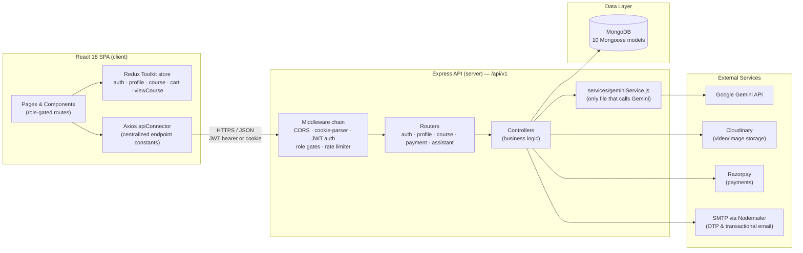
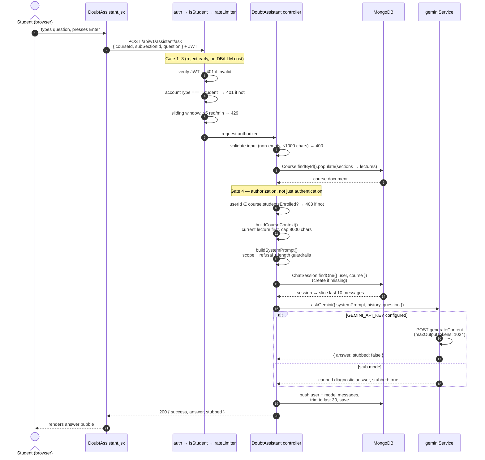

# Synapse

**A full-stack ed-tech platform (course marketplace + LMS) with an AI-powered Course Doubt Assistant.**

Students browse and purchase courses, watch video lectures, and ask questions in an in-player chat panel that answers **using only that course's content**, powered by the Google Gemini API. Instructors author courses with nested sections and video lectures; admins manage categories.


---

## Table of Contents

- [Overview](#overview)
- [Key Features](#key-features)
- [Tech Stack](#tech-stack)
- [High-Level Design (HLD)](#high-level-design-hld)
- [Low-Level Design (LLD)](#low-level-design-lld)
- [Setup](#setup)
- [Usage](#usage)
- [API Overview](#api-overview)
- [Project Structure](#project-structure)
- [Engineering Decisions](#engineering-decisions)

---

## Overview

Synapse has three user roles with distinct capabilities, enforced server-side by Express middleware:

| Role | Capabilities |
|---|---|
| **Student** | Browse catalog, purchase courses, watch lectures, track progress, rate courses, ask the AI Doubt Assistant |
| **Instructor** | Create/edit courses (Course → Sections → Lectures), upload videos, view an earnings dashboard |
| **Admin** | Manage course categories |

The headline feature is the **AI Course Doubt Assistant**: a chat panel inside the video player, available only to students enrolled in that course. The backend assembles context from the course's own data (name, description, section/lecture descriptions — with the currently-playing lecture prioritized), wraps it in a guardrailed system prompt, and calls Gemini. Answers are grounded in course content; off-topic questions are refused by design.

## Key Features

### Platform
- **Authentication & authorization** — JWT sessions (24h expiry, httpOnly cookie), email OTP verification on signup with **MongoDB TTL auto-expiry** (OTP documents self-delete after 5 minutes), bcrypt password hashing, and role-based access control middleware.
- **Course management** — nested content model (Course → Sections → Lectures), video uploads to Cloudinary, draft/published states, category catalog.
- **Payments** — Razorpay order creation with a webhook signature-verification endpoint for enrollment fulfilment.
- **Learning experience** — video player with lecture completion tracking, course progress, ratings & reviews.
- **Password reset** — `crypto.randomBytes` token emailed as a link, expiring after 1 hour.

### AI Course Doubt Assistant
- **Enrollment-gated** — authorization beyond authentication: only students enrolled in *that* course reach the LLM (also protects API quota).
- **Grounded prompting** — context is assembled from the course's own sections/lectures; the lecture the student is currently watching is placed first so it survives truncation.
- **Cost controls** — question capped at 1,000 chars, context at 8,000 chars, only the last 10 messages sent per request, responses budgeted to 1,024 output tokens.
- **Rate limiting** — per-user sliding-window limiter (5 requests/min) on the ask endpoint.
- **Persistent memory** — one `ChatSession` document per (student, course) enforced by a unique compound index, capped at 30 stored messages; conversations survive page reloads.
- **Prompt guardrails** — the system prompt restricts answers to course context, enforces a length budget, and instructs the model to refuse off-topic questions and never reveal its instructions.
- **Stub mode** — with no API key configured, the service returns canned responses, so the entire pipeline (auth → context assembly → persistence → UI) runs with zero external dependencies. Adding a key flips it live with no code changes.

## Tech Stack

| Layer | Technology |
|---|---|
| Frontend | React 18 (CRA), Redux Toolkit, React Router v6, Tailwind CSS, Axios, video-react, Chart.js |
| Backend | Node.js 18+, Express, Mongoose (MongoDB) |
| AI | Google Gemini API (REST `generateContent`) via a single isolated service layer |
| Services | Cloudinary (media), Razorpay (payments), Nodemailer (OTP/transactional email) |
| Auth | JWT, bcrypt, email OTP with TTL expiry |

---

## High-Level Design (HLD)

The system is a classic three-tier SPA + REST API + document store, with third-party integrations isolated behind a `config/` + `services/` boundary so no controller talks to an external vendor directly.



### Component responsibilities

| Component | Responsibility |
|---|---|
| **React SPA** | Rendering, client-side routing with role-gated route guards, optimistic UI state in Redux Toolkit slices |
| **Middleware chain** | Cross-cutting concerns: CORS (locked to the client origin), JWT verification, role enforcement (`isStudent` / `isInstructor` / `isAdmin`), per-user rate limiting on the assistant |
| **Controllers** | Business logic per domain (Auth, Course, Payments, DoubtAssistant, …) — never call external vendors directly |
| **`services/geminiService.js`** | The **single integration point** for the LLM. Owns the stub/live switch. Swapping the model provider touches one file |
| **`config/`** | All third-party client setup (database, Cloudinary, Razorpay, Gemini) isolated from business logic |
| **MongoDB** | 10 Mongoose schemas; notable indexes: TTL on `OTP.createdAt` (5 min), unique compound `(user, course)` on `ChatSession` |

### Data model (core relationships)


---

## Low-Level Design (LLD)

### Doubt Assistant — request lifecycle

The most interesting flow in the system. Every layer either rejects early (cheap) or bounds the work it passes downstream (safe), so the expensive LLM call sits behind four gates.



### Key implementation details

| Concern | Mechanism | Where |
|---|---|---|
| Token-cost ceiling | Hard caps: 1,000-char question, 8,000-char context, 10-message history, 1,024 output tokens | `controllers/DoubtAssistant.js`, `config/gemini.js` |
| Context relevance under truncation | Currently-playing lecture is `unshift`ed to the front of the context before the 8K slice | `buildCourseContext()` |
| Abuse prevention | In-memory sliding-window limiter, per user id (documented upgrade path: Redis) | `doubtRateLimiter` middleware |
| One conversation per student per course | Unique compound index `{ user: 1, course: 1 }` — enforced by the database, not application code | `models/ChatSession.js` |
| OTP expiry | MongoDB TTL index (`expires: 300`) — the database deletes stale OTPs itself | `models/OTP.js` |
| Vendor isolation | Only `services/geminiService.js` knows the Gemini wire format; stub/live decided in `config/gemini.js` | `services/`, `config/` |
| Graceful degradation | No API key → deterministic stub responses; the full pipeline stays testable and demoable | `geminiService.js` |

### Middleware chains per route group

```
/assistant/ask            auth → isStudent → doubtRateLimiter → askDoubt
/assistant/history/:id    auth → isStudent → getChatHistory
/payment/capturePayment   auth → isStudent → capturePayment
/course/createCourse      auth → isInstructor → createCourse
/course/createCategory    auth → isAdmin → createCategory
```

---

## Setup

### Prerequisites

- **Node.js 18+** (native `fetch` is used for the Gemini API) and npm
- **MongoDB** — local instance or an Atlas connection string
- Optional for full functionality: Cloudinary, Razorpay, and SMTP credentials, plus a free Gemini API key from [aistudio.google.com](https://aistudio.google.com)

### 1. Backend

```bash
cd server
npm install
cp .env.sample .env   # fill in real values (see table below)
npm run dev           # nodemon; or npm start
```

Runs on `http://localhost:4000`.

### 2. Frontend

```bash
cd client
npm install
npm start
```

Runs on `http://localhost:3000`. CORS in `server/index.js` is locked to this origin — update both if you change ports.

### Environment variables — `server/.env`

| Variable | Purpose |
|---|---|
| `DATABASE_URL` | MongoDB connection string |
| `PORT` | API port (default 4000) |
| `JWT_SECRET` | Signing secret for auth tokens |
| `MAIL_HOST`, `MAIL_USER`, `MAIL_PASS` | SMTP credentials for OTP/notification emails |
| `CLOUD_NAME`, `API_KEY`, `API_SECRET`, `FOLDER_NAME` | Cloudinary media uploads |
| `RAZORPAY_KEY`, `RAZORPAY_SECRET` | Payment gateway |
| `GEMINI_API_KEY` | Gemini API key — **leave as the placeholder to run in stub mode** |
| `GEMINI_MODEL` | Gemini model id (default `gemini-flash-latest`) |

`.env` is gitignored; `.env.sample` documents every variable with placeholders.

### Environment variables — `client/.env`

| Variable | Purpose |
|---|---|
| `REACT_APP_BASE_URL` | Backend API base, e.g. `http://localhost:4000/api/v1` |

---

## Usage

### As a Student

1. **Sign up** — choose the Student role; a 6-digit OTP is emailed to you (expires in 5 minutes).
2. **Browse & enroll** — explore the catalog by category, add courses to the cart, and check out via Razorpay.
3. **Learn** — open an enrolled course (`/view-course/...`), watch lectures, and mark them complete to track progress.
4. **Ask doubts** — below the video, expand **"Ask a Doubt"** and ask anything about the course. Answers are grounded in the course's section and lecture descriptions, so richer descriptions produce better answers. Your conversation persists per course across reloads. Off-topic questions are politely refused by design.

### As an Instructor

1. Sign up with the Instructor role.
2. From the dashboard, create a course: details → thumbnail → sections → video lectures (uploaded to Cloudinary).
3. Publish when ready; track enrollments and income on the instructor dashboard.

### Stub mode (no API key)

Without a `GEMINI_API_KEY`, the assistant returns diagnostic placeholder replies that echo how much context and history *would* have been sent — useful for development and for demoing the pipeline (auth, gating, persistence, UI) with zero external dependencies.

---

## API Overview

All routes are mounted under `/api/v1` — **35 REST endpoints across 5 routers**:

| Router | Mount | Highlights |
|---|---|---|
| User | `/auth` | signup, login, sendotp, changepassword, reset-password flow |
| Profile | `/profile` | user details, enrolled courses, instructor dashboard, display picture |
| Course | `/course` | course/section/lecture CRUD, categories, ratings & reviews, progress |
| Payments | `/payment` | capturePayment (order creation), verifySignature (webhook) |
| **Assistant** | `/assistant` | `POST /ask`, `GET /history/:courseId` |

---

## Project Structure

```
Synapse/
├── server/                         Express API
│   ├── index.js                    Entry: middleware, route mounting, DB/Cloudinary connect
│   ├── config/                     database, cloudinary, razorpay, gemini
│   │                               (ALL third-party setup isolated here)
│   ├── middlewares/auth.js         JWT guard + isStudent / isInstructor / isAdmin role gates
│   ├── controllers/                Auth, Course, Section, Subsection, Profile, Payments,
│   │                               RatingAndReview, ResetPassword, Category, DoubtAssistant
│   ├── models/                     10 Mongoose schemas (User, Course, Section, SubSection,
│   │                               Category, Profile, CourseProgress, OTP, RatingAndReview,
│   │                               ChatSession)
│   ├── routes/                     Routers mounted under /api/v1/*
│   ├── services/geminiService.js   The ONLY file that talks to the Gemini API (stub/live switch)
│   ├── mail/templates/             HTML email templates
│   └── utils/                      imageUploader (Cloudinary), mailSender (Nodemailer)
│
└── client/                         React SPA
    ├── src/App.jsx                 Route table (role-gated dashboard + view-course routes)
    ├── src/slices/                 Redux Toolkit slices (auth, profile, course, cart, viewCourse)
    ├── src/services/
    │   ├── apiConnector.js         Axios instance (baseURL from env)
    │   ├── apis.js                 Centralized endpoint constants
    │   └── operations/             API call wrappers, incl. assistantAPI.js
    ├── src/components/core/ViewCourse/DoubtAssistant.jsx   The chat panel
    └── src/pages/                  Route-level pages (Home, Catalog, Dashboard, ViewCourse, …)
```

---

## Engineering Decisions

A few choices worth calling out, and their trade-offs:

- **Grounding via prompt-injected context instead of a vector DB.** Course content is small enough (≤8K chars after truncation) that stuffing it into the system prompt beats the operational cost of embeddings + retrieval. The current-lecture-first ordering is a cheap relevance heuristic that does most of what a retriever would. If courses grew large, the upgrade path is chunked embeddings with retrieval scoped per course.
- **In-memory rate limiter.** Deliberately simple: a `Map` of user id → timestamps with a sliding window. Known limitation (documented in code): per-process, resets on restart, doesn't share across instances. Upgrade path: Redis sliding window.
- **Database-enforced invariants over application checks.** OTP expiry is a TTL index, one-chat-per-(student, course) is a unique compound index. The database guarantees these even if application code regresses.
- **Every LLM input is bounded.** Question, context, history, and output tokens all have hard caps, so no single request — malicious or accidental — can produce an unbounded bill.
- **Stub-first external integration.** The Gemini service was built stub-first, which forced a clean seam: the rest of the system depends on the service's contract (`{ answer, stubbed }`), not on Gemini. This is also why the whole app is runnable with nothing but Node and MongoDB.
